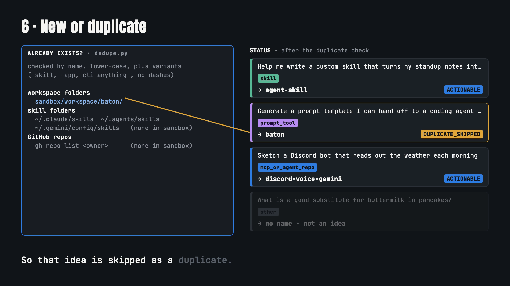

# gemini-activity-harvester

A Python command-line tool for people who brainstorm tools in Google Gemini: it reads your own Gemini prompt history, flags the prompts that asked for a skill, prompt tool or bot, and tells you which of those you have not built yet.

[](https://nojuannobody.github.io/gemini-activity-harvester/explainer/explainer.mp4)

[▶ Watch the 68-second explainer](https://nojuannobody.github.io/gemini-activity-harvester/explainer/explainer.mp4) · [Read the one-page explainer](https://nojuannobody.github.io/gemini-activity-harvester/explainer/)

### How it works for you

1. **Bring your history.** Copy your activity from `myactivity.google.com/product/gemini` into a text file, or (macOS + Google Chrome) keep that page open and run `scrape`.
2. **It sorts each prompt.** Keyword rules give every prompt a type (`skill`, `prompt_tool`, `mcp_or_agent_repo` or `other`) and a suggested project name from a fixed list.
3. **It checks what you already have.** Each name is compared with folders in your workspace, your local skill folders and `gh repo list <owner>`.
4. **You get a report.** JSON (saved to `scrapes/` by `scrape`) plus a printed list of new ideas marked `ACTIONABLE` and existing ones marked `DUPLICATE_SKIPPED`. Building the new ones is still up to you.

Status: working prototype. The rules and defaults are tuned to the author's own projects (default workspace `/Users/alejandrolondono/dev`, default owner `NoJuanNobody`; pass `--owner` for yours).

Autonomous skill and toolchain to scrape, index, and audit Google Gemini activity history (`myactivity.google.com/product/gemini`), identify actionable prompt tools, skills, and architectures, and deduplicate against existing local and remote repositories. Scaffolding new packages from the results ("swarm") is described in `SKILL.md` but not implemented yet.

## Features

- **Activity Index Parser**: Ingests Google MyActivity streams, extracting prompts, voice audio attachments, timestamps, and model responses.
- **Intent Classification**: Classifies conversation records into:
  - Agent Skills (`SKILL.md`)
  - Prompt Tools (e.g., agent handoff protocols)
  - Autonomous System Repositories (e.g., Discord Gemini voice bot, OpenHaul logistics loop, KiCad agent tools)
- **Multi-Level Deduplication**: Cross-checks candidates against `~/dev`, local agent skills registries (`~/.gemini/config/skills/`, `~/.agents/skills/`), and the user's remote GitHub repositories (`gh repo list`) and skips names (and simple variants) that already exist.
- **Verification Engine**: Built-in `unittest` suite. Note: two of the five tests (`test_deduplicator`, `test_harvest_and_audit`) expect the author's own `~/dev` folders and GitHub repos.

## Installation

### Via `npx skills`
Install the skill into your coding agent environment with [`npx skills`](https://skills.sh):

```bash
npx skills add NoJuanNobody/gemini-activity-harvester -g
```

### Local Development
```bash
git clone https://github.com/NoJuanNobody/gemini-activity-harvester.git
cd gemini-activity-harvester
pip install -e .
```

> Note: at commit 47d6957, `pip install` fails with current setuptools (`command 'install' has no such option 'install_layout'`, from `setup.py`). Until that is fixed, run the CLI from the checkout with `PYTHONPATH=. python3 -m gemini_activity_harvester.cli <subcommand>`.

## Running Tests

```bash
python3 -m unittest discover -s tests
```

## License
MIT
